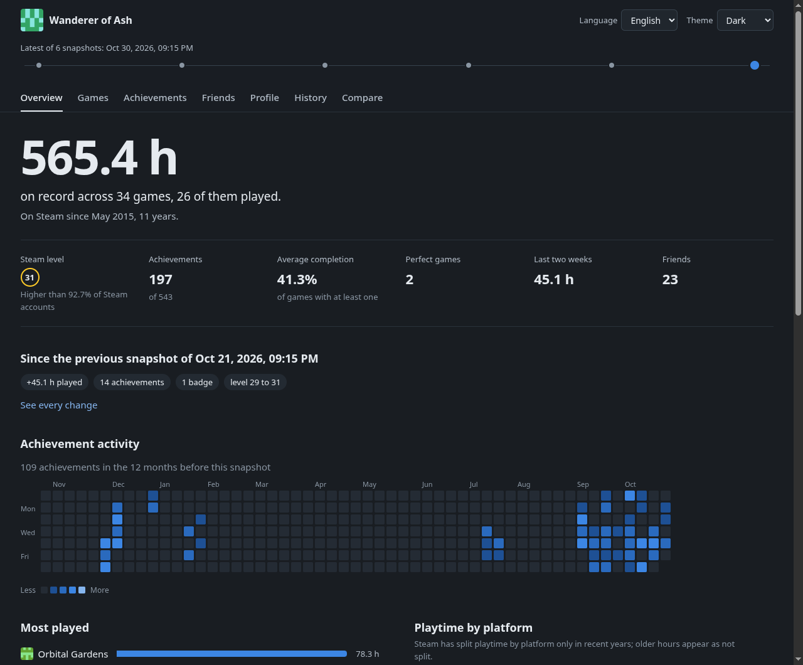

<div align="center">

# steamledger

**Your Steam account, archived on your own disk and browsable offline.**

[](LICENSE)
[](pyproject.toml)
[](#windows-linux-and-macos)

English · [Türkçe](README.tr.md)



</div>

---

Give it a Steam Web API key and your Steam ID. Every run saves a dated snapshot
of your profile, library, playtime, achievements, friends, badges and wishlist,
then builds a static site from all of them. Nothing needs a server, a database
engine or an internet connection once it has been collected: every file in
`database/` opens with a double click.

Because each snapshot is kept, you can go back to any date and see exactly what
changed in between: hours played per game, achievements unlocked, games added,
friends who came, went or changed their name, level and badge progress.

- **No dependencies.** Python 3.10+ standard library only.
- **Offline.** Avatars, game art and achievement icons are downloaded next to the data.
- **Two languages.** English and Turkish for the terminal, the reports and the site.
- **Your data stays yours.** The API key lives in `config.json` and never enters `database/` or `site/`.

## Quick start

```sh
git clone https://github.com/abel0x/steamledger
cd steamledger

python -m steamledger setup      # paste the API key and your Steam ID
python -m steamledger collect    # take the first snapshot and build the site
python -m steamledger open       # open the site
```

On Windows use `py` instead of `python`. Running `python -m steamledger` with no
command opens a small menu that does the same things; so does a double-click on
`steamledger.cmd` on Windows or running `./steamledger.sh` on Linux and macOS.

Get a key at **<https://steamcommunity.com/dev/apikey>** (any domain name works).
For the Steam ID, anything that identifies the account is accepted:

| You have | Example |
| --- | --- |
| SteamID64 | `76561197960287930` |
| Profile URL | `https://steamcommunity.com/profiles/76561197960287930` |
| Custom URL or its name | `https://steamcommunity.com/id/gabelogannewell` or `gabelogannewell` |
| Friend code | `22202` |
| Steam2 / Steam3 | `STEAM_0:0:11101`, `[U:1:22202]` |

Want to look around first? `python -m steamledger demo` builds a full archive and
site in `demo/` from an invented account, without a key or a network.

### Privacy settings

Steam only hands out what the profile shares. For a full archive set, in
**Edit Profile → Privacy Settings**: *My profile* to **Public**, *Game details*
to **Public**, and *Friends List* to **Public**. `python -m steamledger doctor`
checks the key, the account and these settings and says what is missing.
Sections Steam refuses are marked as private in the snapshot instead of failing
the run.

## What is in here

```
config.json          your key, account and options (created by setup, never committed)
database/            the archive; open database/index.html
  index.html         every snapshot with a link to its report
  latest/            the newest snapshot, always at the same path
  archive/<date>/    one folder per snapshot: report.html, *.json, *.csv, changes.json
  changes/           comparisons saved with `diff --save`
  media/             images for offline viewing
site/                the static site; open site/index.html
```

Each snapshot folder holds the raw data as JSON, the main tables as CSV for
spreadsheets, a readable `report.html` (`report.tr.html` in Turkish) and
`changes.json` with what changed since the snapshot before it.

The site has an overview, games, achievements, friends, profile, history and
compare pages, with a light and a dark theme. A timeline at the top switches the
whole site to any older snapshot; the compare page puts any two side by side.
It works straight from the file system and can also be served with
`python -m steamledger serve` or put on any static host.

## Commands

```sh
python -m steamledger collect             # new snapshot (--full ignores the cache, --no-media skips images)
python -m steamledger list                # saved snapshots, numbered
python -m steamledger show [snapshot]     # summary of one snapshot
python -m steamledger diff 2026-10-01     # what changed since then (newer defaults to latest)
python -m steamledger diff 1 3 --save     # compare two snapshots and keep the result as HTML + JSON
python -m steamledger build               # rebuild the site from the database, no network
python -m steamledger open [site|database|report]
python -m steamledger serve [--port 8765]
python -m steamledger prune --keep 30     # or --before 2026-01-01; --dry-run shows what would go
python -m steamledger config set media.achievement_icons all
python -m steamledger doctor
```

A snapshot can be named by `latest`, `previous`, its number in `list`, a date
or its id. Add `--lang tr` (or `en`) to any command to override the language;
by default it follows `config.json`, then the system.

### Collecting automatically

```sh
python -m steamledger schedule install              # every day at 21:00
python -m steamledger schedule install --weekly --time 09:30
python -m steamledger schedule status
python -m steamledger schedule remove
```

This registers a Task Scheduler task on Windows (it catches up on a run missed
while the computer was off), a systemd user timer on Linux, and a cron entry on
macOS or where systemd is not running. Scheduled runs append to
`database/collect.log`.

## Settings

`config.json` is plain JSON; `python -m steamledger config show` lists every
option with its value. The ones worth knowing:

| Key | Default | Meaning |
| --- | --- | --- |
| `language` | `auto` | `en`, `tr` or `auto` (system language) |
| `store_country` | `auto` | store region for prices and release data; `auto` uses the profile's country |
| `collect.achievements_of_unplayed_games` | `false` | also read achievements of games never started |
| `collect.friend_levels` | `true` | look up each friend's Steam level |
| `media.achievement_icons` | `unlocked` | `unlocked`, `all` or `none` |
| `media.achievement_icon_limit` | `1500` | skip the icons of games with more achievements than this; `0` for no limit |
| `output.csv_delimiter` | `,` | use `;` for spreadsheet programs that expect it |
| `network.requests_per_second` | `8` | stay well below Steam's rate limit |

`STEAM_API_KEY` and `STEAM_ID` environment variables override the file, and
`STEAMLEDGER_HOME` moves the whole project folder (config, database and site)
elsewhere.

## Windows, Linux and macOS

Everything is written with `pathlib`, UTF-8 and portable file names, so a
`database/` copied between systems keeps working. Files are replaced
atomically, which keeps the archive intact if a run is interrupted. The site
and reports use relative links only.

## Development

```sh
python -m unittest discover -s tests -t .    # the whole suite, standard library only
ruff check . && ruff format --check .         # what CI runs besides the tests
```

The tests run the demo account end to end through the real collector and
every command, check that the API key never reaches the database, and hold the
Python and JavaScript diff engines (`steamledger/diff.py`,
`steamledger/web/assets/diff.js`) to identical output when Node.js is installed.
Unit tests cover parsing, the HTTP retry policy, the config file, the snapshot
store, the reports and the scheduler definitions. Translations live in
`steamledger/locales/`; a test keeps `tr.json` in step with `en.json` and checks
that every key the code uses exists.

## License

[Apache License 2.0](LICENSE) © abel0x. Steam and the Steam logo are trademarks
of Valve Corporation; this project is not affiliated with Valve. Data comes from
the [Steam Web API](https://steamcommunity.com/dev).
