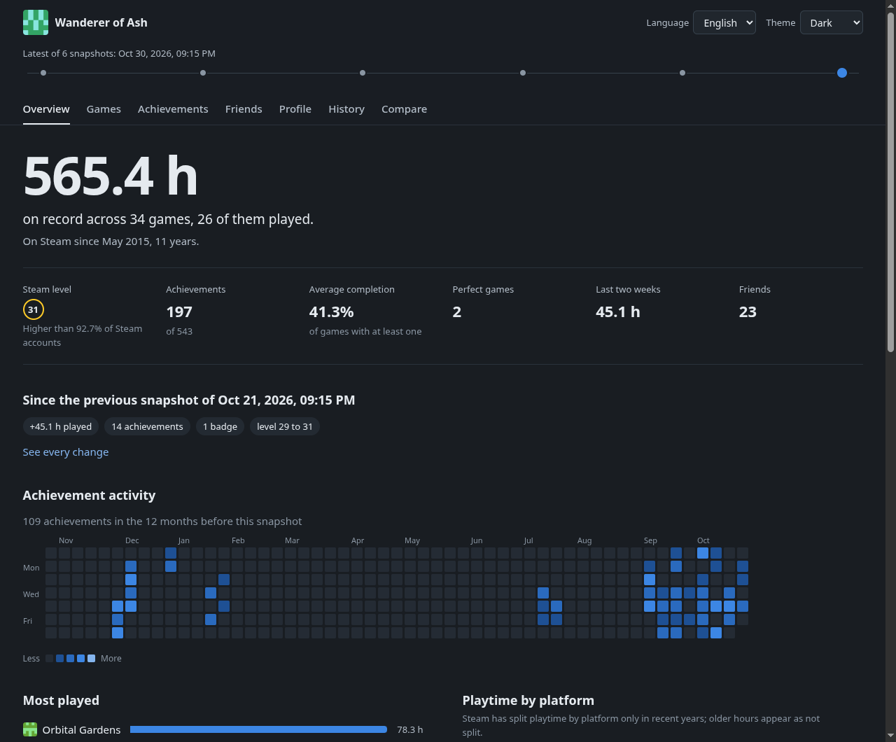

<div align="center">

# steamledger

**Steam hesabın, kendi diskinde arşivlenmiş ve çevrimdışı gezilebilir halde.**

[](LICENSE)
[](pyproject.toml)
[](#windows-linux-ve-macos)

[English](README.md) · Türkçe



</div>

---

Bir Steam Web API anahtarı ve Steam kimliğini ver. Her çalıştırmada profilinin,
kütüphanenin, oynama sürelerinin, başarımlarının, arkadaşlarının, rozetlerinin
ve istek listenin tarihli bir kaydı alınır; ardından bunların hepsinden statik
bir site oluşturulur. Veriler toplandıktan sonra sunucu, veritabanı motoru ya da
internet bağlantısı gerekmez: `database/` içindeki her dosya çift tıklayınca açılır.

Her kayıt saklandığı için istediğin tarihe dönüp arada tam olarak neyin
değiştiğini görebilirsin: oyun başına oynanan saatler, açılan başarımlar,
eklenen oyunlar, gelen, giden ya da adını değiştiren arkadaşlar, seviye ve rozet
ilerlemesi.

- **Bağımlılık yok.** Yalnızca Python 3.10+ standart kütüphanesi.
- **Çevrimdışı.** Avatarlar, oyun görselleri ve başarım simgeleri verinin yanına indirilir.
- **İki dil.** Terminal, raporlar ve site için İngilizce ve Türkçe.
- **Veri senin.** API anahtarı `config.json` içinde kalır; `database/` ya da `site/` içine asla girmez.

## Hızlı başlangıç

```sh
git clone https://github.com/abel0x/steamledger
cd steamledger

python -m steamledger setup      # API anahtarını ve Steam kimliğini gir
python -m steamledger collect    # ilk kaydı al ve siteyi oluştur
python -m steamledger open       # siteyi aç
```

Windows'ta `python` yerine `py` kullan. `python -m steamledger` komutsuz
çalıştırılırsa aynı işleri yapan küçük bir menü açılır; Windows'ta
`steamledger.cmd` dosyasına çift tıklamak ya da Linux ve macOS'ta
`./steamledger.sh` çalıştırmak da aynı menüyü açar.

Anahtarı **<https://steamcommunity.com/dev/apikey>** adresinden al (alan adı
olarak herhangi bir şey yazılabilir). Steam kimliği için hesabı belirten her
biçim kabul edilir:

| Elindeki | Örnek |
| --- | --- |
| SteamID64 | `76561197960287930` |
| Profil bağlantısı | `https://steamcommunity.com/profiles/76561197960287930` |
| Özel URL ya da adı | `https://steamcommunity.com/id/gabelogannewell` veya `gabelogannewell` |
| Arkadaş kodu | `22202` |
| Steam2 / Steam3 | `STEAM_0:0:11101`, `[U:1:22202]` |

Önce bir göz atmak mı istiyorsun? `python -m steamledger demo`, uydurma bir
hesaptan `demo/` klasörüne anahtar ya da ağ olmadan eksiksiz bir arşiv ve site
oluşturur.

### Gizlilik ayarları

Steam yalnızca profilin paylaştığını verir. Tam bir arşiv için
**Profili Düzenle → Gizlilik Ayarları** altında *Profilim*, *Oyun ayrıntıları*
ve *Arkadaş listesi* seçeneklerini **Herkese açık** yap.
`python -m steamledger doctor` anahtarı, hesabı ve bu ayarları denetler, eksik
olanı söyler. Steam'in vermediği bölümler çalıştırmayı durdurmaz; kayıtta gizli
olarak işaretlenir.

## İçinde neler var

```
config.json          anahtarın, hesabın ve ayarların (setup oluşturur, asla commitlenmez)
database/            arşiv; database/index.tr.html dosyasını aç
  index.tr.html      tüm kayıtlar ve raporlarının bağlantıları
  latest/            en yeni kayıt, her zaman aynı yolda
  archive/<tarih>/   her kayıt için bir klasör: report.tr.html, *.json, *.csv, changes.json
  changes/           `diff --save` ile kaydedilen karşılaştırmalar
  media/             çevrimdışı görüntüleme için görseller
site/                statik site; site/index.html dosyasını aç
```

Her kayıt klasöründe ham veriler JSON olarak, ana tablolar hesap tabloları için
CSV olarak, okunabilir bir `report.tr.html` (İngilizcesi `report.html`) ve bir
önceki kayıttan bu yana neyin değiştiğini tutan `changes.json` bulunur.

Sitede genel bakış, oyunlar, başarımlar, arkadaşlar, profil, geçmiş ve
karşılaştırma sayfaları ile açık ve koyu tema vardır. Üstteki zaman çizelgesi
tüm siteyi daha eski bir kayda geçirir; karşılaştırma sayfası istediğin iki
kaydı yan yana koyar. Site doğrudan dosya sisteminden çalışır;
`python -m steamledger serve` ile sunulabilir ya da herhangi bir statik barındırmaya
konabilir.

## Komutlar

```sh
python -m steamledger collect             # yeni kayıt (--full önbelleği yok sayar, --no-media görselleri atlar)
python -m steamledger list                # kayıtlı kayıtlar, numaralı
python -m steamledger show [kayıt]        # bir kaydın özeti
python -m steamledger diff 2026-10-01     # o tarihten bu yana ne değişti (yenisi varsayılan olarak en son kayıt)
python -m steamledger diff 1 3 --save     # iki kaydı karşılaştır, sonucu HTML + JSON olarak sakla
python -m steamledger build               # siteyi veritabanından yeniden oluştur, ağ gerekmez
python -m steamledger open [site|database|report]
python -m steamledger serve [--port 8765]
python -m steamledger prune --keep 30     # ya da --before 2026-01-01; --dry-run neyin silineceğini gösterir
python -m steamledger config set media.achievement_icons all
python -m steamledger doctor
```

Bir kayda `latest`, `previous`, `list` çıktısındaki numarası, bir tarih ya da
kimliğiyle başvurulabilir. Dili değiştirmek için herhangi bir komuta
`--lang tr` (veya `en`) ekle; varsayılan olarak önce `config.json`, sonra
sistem dili kullanılır.

### Otomatik toplama

```sh
python -m steamledger schedule install              # her gün 21:00'de
python -m steamledger schedule install --weekly --time 09:30
python -m steamledger schedule status
python -m steamledger schedule remove
```

Windows'ta bir Görev Zamanlayıcı görevi (bilgisayar kapalıyken kaçan
çalıştırmayı sonradan yapar), Linux'ta bir systemd kullanıcı zamanlayıcısı,
macOS'ta ya da systemd çalışmayan sistemlerde bir cron girdisi kaydeder.
Zamanlanmış çalıştırmalar çıktılarını `database/collect.log` dosyasına ekler.

## Ayarlar

`config.json` düz bir JSON dosyasıdır; `python -m steamledger config show` tüm
ayarları değerleriyle listeler. Bilmeye değer olanlar:

| Anahtar | Varsayılan | Anlamı |
| --- | --- | --- |
| `language` | `auto` | `en`, `tr` ya da `auto` (sistem dili) |
| `store_country` | `auto` | fiyat ve çıkış bilgileri için mağaza bölgesi; `auto` profildeki ülkeyi kullanır |
| `collect.achievements_of_unplayed_games` | `false` | hiç başlanmamış oyunların başarımlarını da oku |
| `collect.friend_levels` | `true` | her arkadaşın Steam seviyesine bak |
| `media.achievement_icons` | `unlocked` | `unlocked`, `all` ya da `none` |
| `media.achievement_icon_limit` | `1500` | bundan fazla başarımı olan oyunların simgelerini indirme; sınırsız için `0` |
| `output.csv_delimiter` | `,` | bunu bekleyen hesap tablosu programları için `;` kullan |
| `network.requests_per_second` | `8` | Steam'in istek sınırının epey altında kal |

`STEAM_API_KEY` ve `STEAM_ID` ortam değişkenleri dosyadakini geçersiz kılar;
`STEAMLEDGER_HOME` tüm proje klasörünü (ayarlar, veritabanı ve site) başka bir
yere taşır.

## Windows, Linux ve macOS

Her şey `pathlib`, UTF-8 ve taşınabilir dosya adlarıyla yazılır; bu yüzden
sistemler arasında kopyalanan bir `database/` çalışmaya devam eder. Dosyalar
atomik olarak değiştirilir, böylece yarıda kesilen bir çalıştırma arşivi bozmaz.
Site ve raporlar yalnızca göreli bağlantılar kullanır.

## Geliştirme

```sh
python -m unittest discover -s tests -t .    # tüm testler, yalnızca standart kütüphane
ruff check . && ruff format --check .         # CI'ın testler dışında çalıştırdıkları
```

Testler demo hesabını gerçek toplayıcıdan ve tüm komutlardan uçtan uca geçirir,
API anahtarının veritabanına hiç ulaşmadığını denetler ve Node.js kuruluysa
Python ile JavaScript karşılaştırma motorlarının (`steamledger/diff.py`,
`steamledger/web/assets/diff.js`) birebir aynı sonucu vermesini şart koşar.
Birim testleri ayrıştırmayı, HTTP yeniden deneme kuralını, ayar dosyasını, kayıt
deposunu, raporları ve zamanlayıcı tanımlarını kapsar. Çeviriler
`steamledger/locales/` içindedir; bir test `tr.json` dosyasını `en.json` ile eşit
tutar ve kodun kullandığı her anahtarın var olduğunu denetler.

## Lisans

[Apache Lisansı 2.0](LICENSE) © abel0x. Steam ve Steam logosu Valve
Corporation'ın ticari markalarıdır; bu proje Valve ile bağlantılı değildir.
Veriler [Steam Web API](https://steamcommunity.com/dev) üzerinden alınır.
